# Manuel de rédaction : un source, trois rendus

Ce manuel montre, exemples et captures à l'appui, comment un même chapitre
Typst produit **trois rendus différents** :

| Cible | Commande | Pour qui |
|---|---|---|
| **A4** (PDF) | `make a4` | le lecteur : texte complet, à imprimer ou lire seul |
| **Site** (HTML) | `make site` | le lecteur en ligne : texte complet, réponses repliables |
| **Slides** (PDF 16:9) | `make slides` | le formateur : diapos courtes + **notes de l'orateur** |

Principe : **l'A4 et le site sont développés, les slides sont synthétiques.**
On écrit le texte complet une seule fois, puis on indique ce qui va sur la diapo
avec quelques blocs :

| Bloc | A4 / site | Slides |
|---|---|---|
| (texte normal, sans bloc) | affiché | affiché |
| `#synthese[…]` | encadré bleu « 🎯 À retenir » | **contenu de la diapo** |
| `#developpement[…]` | texte normal | **note de l'orateur** (rien sur la diapo) |
| `#diapo[…]` | absent | affiché |
| `#selon(slides: [court])[long]` | version longue | version courte |
| `#ajuster[…]` | inchangé | texte réduit (jusqu'à 60 %) pour tenir sur la diapo |
| `#question[énoncé][réponse]` | A4 : renvoi vers un corrigé en fin de chapitre ; site : réponse repliée | une diapo question, puis la même avec la réponse |

Sommaire :

1. [`#synthese` + `#developpement` : la section type](#1-synthese--developpement--la-section-type)
2. [`#diapo` : une ligne pour la diapo seulement](#2-diapo--une-ligne-pour-la-diapo-seulement)
3. [`#selon` : version courte d'un bloc en place](#3-selon--version-courte-dun-bloc-en-place)
4. [Titre dans un `#developpement` : sous-section réservée à l'écrit](#4-titre-dans-un-developpement--sous-section-réservée-à-lécrit)
5. [`#ajuster` : faire tenir une diapo trop pleine](#5-ajuster--faire-tenir-une-diapo-trop-pleine)
6. [`#question`, `#reponse`, `#details`](#6-question-reponse-details)
7. [Notes de l'orateur : où les lire](#7-notes-de-lorateur--où-les-lire)
8. [Aide-mémoire : quel bloc choisir ?](#8-aide-mémoire--quel-bloc-choisir-)
9. [Thèmes visuels : changer l'habillage](#9-thèmes-visuels--changer-lhabillage)

> **À propos des captures.** Elles sont produites à partir des petits fichiers
> de [manuel/exemples/](manuel/exemples/), compilés tels quels avec le thème du
> cours, par `bash docs/manuel/captures.sh` (à relancer si `lib/theme.typ`
> change). Seule différence avec le vrai cours : les pages A4 sont rognées à
> leur contenu (ligne `#set page(height: auto) if est-a4` des exemples), pour
> ne pas montrer une demi-page blanche. La diapo de titre, le sommaire et la
> diapo de chapitre ne sont pas montrés.

---

## 1. `#synthese` + `#developpement` : la section type

C'est le cas le plus courant : quelques puces qui résument (la diapo), puis le
texte complet (le support écrit).

Source : [manuel/exemples/01-synthese-developpement.typ](manuel/exemples/01-synthese-developpement.typ)

```typst
== ➡️ Réduire le _dwell time_

#synthese[
  - *Dwell time* : présence non détectée de l'attaquant dans le SI
  - *MTTD* : moyenne du dwell time sur tous les incidents
  - Objectif : passer de « semaines » à « heures »
]

#developpement[
  - *Dwell time* = durée pendant laquelle l'attaquant est présent dans le SI
    sans être détecté (de la compromission initiale à la détection).
  - Le *MTTD (Mean Time To Detect)* est sa moyenne sur l'ensemble des incidents.

  Plus le dwell time est court, moins l'attaquant a le temps de progresser.

  #note[C'est la métrique de résultat d'un programme de détection.]
]
```

| A4 | Slides |
|---|---|
| 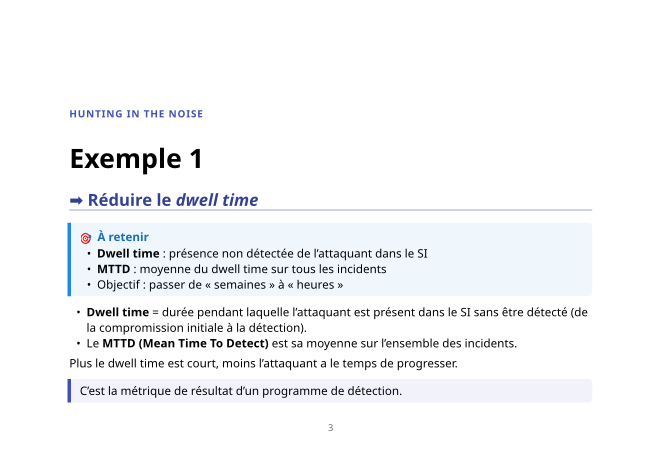 | 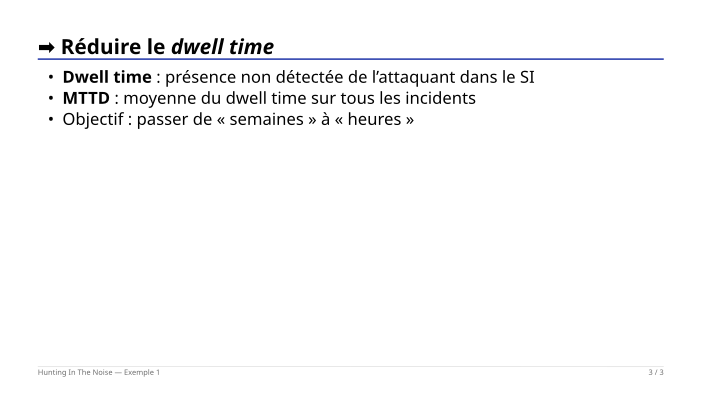 |

**Site :**

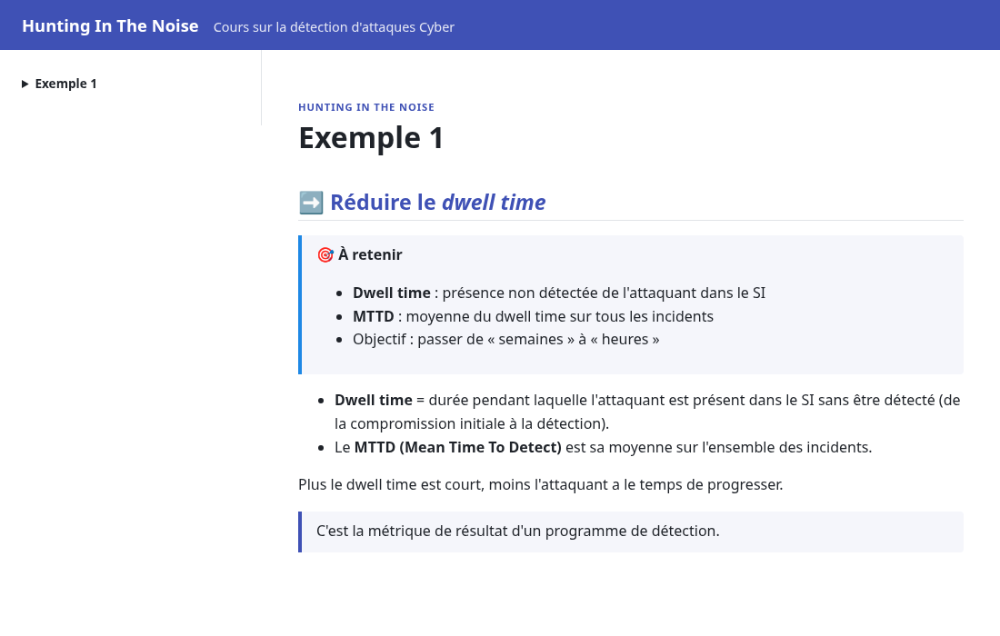

**Ce qui se passe :**

- **A4 et site** : la synthèse devient l'encadré bleu « 🎯 À retenir », suivi
  du texte du `#developpement`, affiché normalement (puces, paragraphe,
  encadré `#note`).
- **Slides** : la diapo ne montre **que** les 3 puces de la synthèse. Le
  `#developpement` disparaît de la diapo et devient la **note de l'orateur**
  de cette diapo (cf. [§ 7](#7-notes-de-lorateur--où-les-lire)) :

  ```markdown
  - **Dwell time** = durée pendant laquelle l'attaquant est présent dans le SI sans être détecté (de la compromission initiale à la détection).
  - Le **MTTD (Mean Time To Detect)** est sa moyenne sur l'ensemble des incidents.

  Plus le dwell time est court, moins l'attaquant a le temps de progresser.

  C'est la métrique de résultat d'un programme de détection.
  ```

  Le cadre du `#note` est perdu (la note est du texte seul), mais son texte
  est gardé.

---

## 2. `#diapo` : une ligne pour la diapo seulement

Quand le développement part en note mais que la diapo doit garder l'idée
maîtresse, on l'écrit dans `#diapo` : elle n'apparaît **que** dans les slides.

Source : [manuel/exemples/02-diapo.typ](manuel/exemples/02-diapo.typ)

```typst
== Prioriser les alertes

Une détection « parfaite » sur le papier mais qui produit 95 % de faux
positifs a un coût opérationnel qui dépasse sa valeur 🤯

#diapo[
  *Prioriser* : score de risque = confiance × impact (_risk-based alerting_)
]

#developpement[#note[
  Prioriser les alertes de l'organisation
  - _Confiance_ : probabilité que ce soit réellement malveillant.
  - _Impact potentiel_ : gravité si c'est vrai, pondérée par la criticité de
    l'actif touché (un DC vs un poste de test).
]]
```

| A4 | Slides |
|---|---|
| 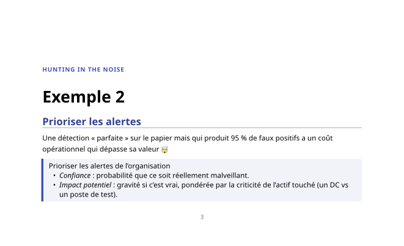 | 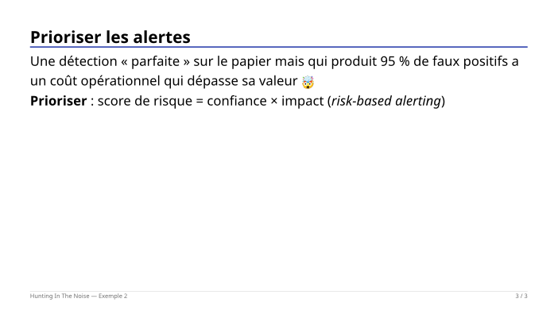 |

**Site :**

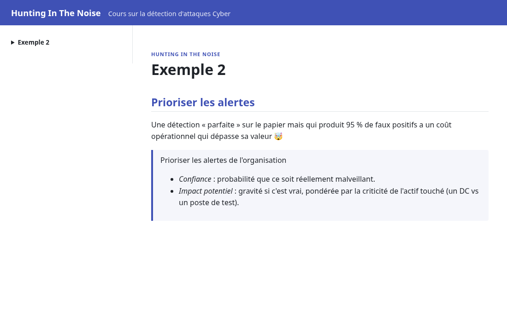

**Ce qui se passe :**

- Le paragraphe « Une détection parfaite… » est hors de tout bloc : il est
  **identique partout**.
- La ligne « **Prioriser** : score de risque… » n'existe **que sur la diapo**.
- L'encadré `#note` n'existe **qu'en A4 et sur le site** ; dans les slides,
  son texte est dans les notes de l'orateur :

  ```markdown
  Prioriser les alertes de l'organisation
  - _Confiance_ : probabilité que ce soit réellement malveillant.
  - _Impact potentiel_ : gravité si c'est vrai, pondérée par la criticité de l'actif touché (un DC vs un poste de test).
  ```

> `#diapo` est l'inverse de `#developpement` : l'un n'existe qu'en slides,
> l'autre partout sauf sur la diapo.

---

## 3. `#selon` : version courte d'un bloc en place

`#synthese` / `#developpement` empilent leur contenu. Quand le texte est pris
dans une mise en page (ici deux colonnes texte | image), on veut **remplacer**
le texte long par un texte court sans toucher au reste : c'est `#selon`.

Source : [manuel/exemples/03-selon.typ](manuel/exemples/03-selon.typ)

```typst
== 😈 Augmenter le coût pour l'attaquant

#colonnes[
  #selon(slides: [
    🧐 *Le défenseur doit maximiser le coût de contournement.*

    - tous les indicateurs ne se valent pas ;
    - la valeur vient de ceux qui sont coûteux à modifier.
  ])[
    🧐 L'adversaire doit contourner la détection (identifier ce qui est
    difficile à changer pour lui) : *le défenseur doit donc maximiser ce coût !*

    Créée par *David Bianco en 2013*, la Pyramide de la douleur classe …

    - Tous les indicateurs ne se valent pas (…)
    - La vraie valeur défensive vient des indicateurs coûteux à modifier.
  ]
][
  #illustration("/images/pyramide-de-la-douleur.svg", alt: "La Pyramide de la douleur", largeur: 90%)
]
```

| A4 (version longue) | Slides (version courte) |
|---|---|
| 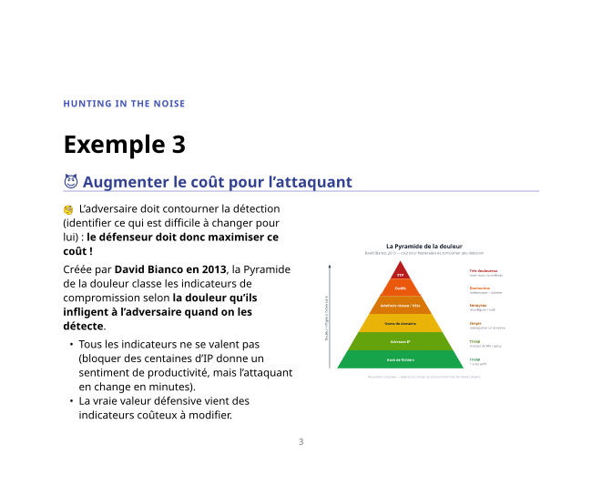 | 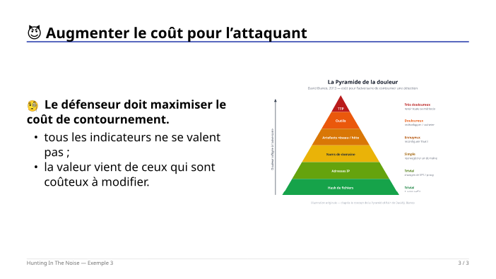 |

**Site (version longue) :**

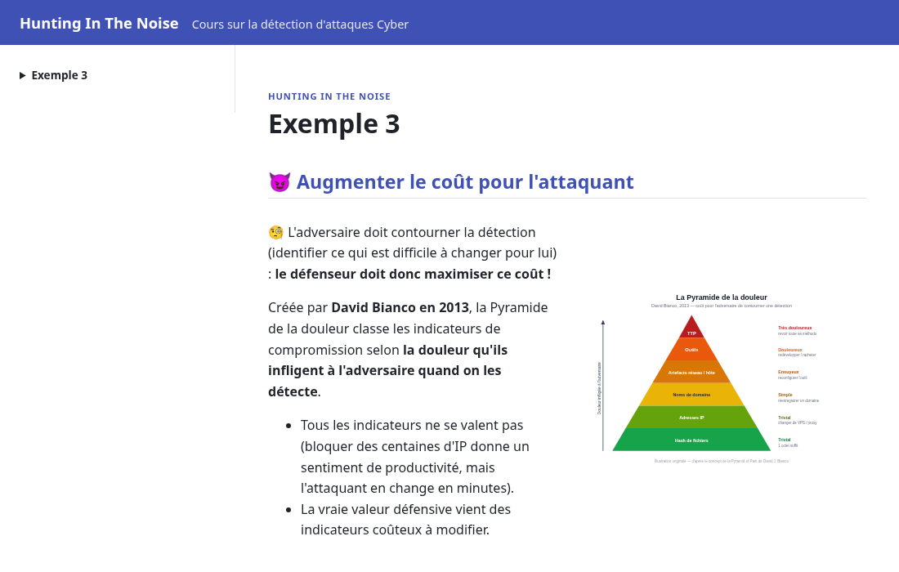

**Ce qui se passe :** la colonne de gauche contient le texte long en A4 et
sur le site, le texte court (argument `slides:`) sur la diapo. L'image reste à
droite partout.

> Contrairement à `#developpement`, la version longue d'un `#selon` ne passe
> **pas** dans les notes de l'orateur. Si le formateur en a besoin, ajouter un
> `#developpement[…]` à côté.

---

## 4. Titre dans un `#developpement` : sous-section réservée à l'écrit

Dans les slides, **chaque titre de niveau 1 à 3 ouvre une nouvelle diapo**.
Un titre placé **dans** un `#developpement` n'existe pas en slides : il ne
crée donc pas de diapo, et son texte (titre compris) devient la note de la
diapo précédente.

Source : [manuel/exemples/04-sous-section-ecrite.typ](manuel/exemples/04-sous-section-ecrite.typ)

```typst
== Les niveaux de la pyramide

#synthese[
  - Du *hash* (trivial à changer) aux *TTP* (très coûteux)
  - Viser le haut de la pyramide pour durer
]

#developpement[
=== Lecture des niveaux

- *Hash* : recompiler ou ajouter un octet suffit, la détection est morte.
- *IP* : rotation quasi gratuite d'infrastructure.
- *TTP* : l'attaquant doit repenser sa façon d'opérer.
]

== Section suivante

#synthese[
  - Cette diapo suit directement « Les niveaux de la pyramide »
]
```

| A4 : la sous-section « Lecture des niveaux » est là | Slides : pas de diapo « Lecture des niveaux » |
|---|---|
| 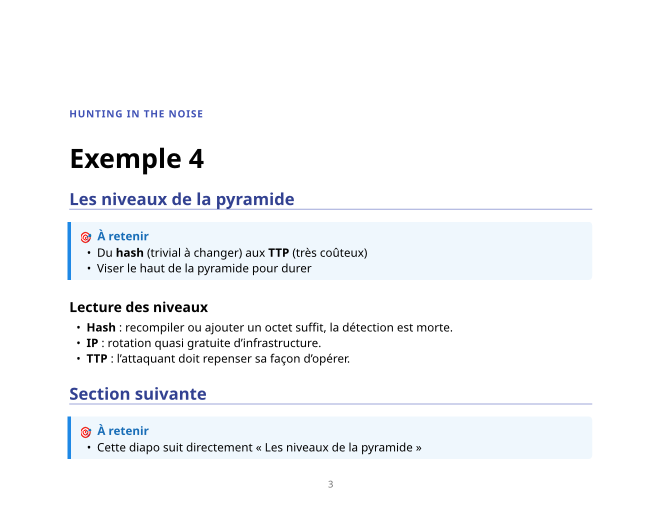 | 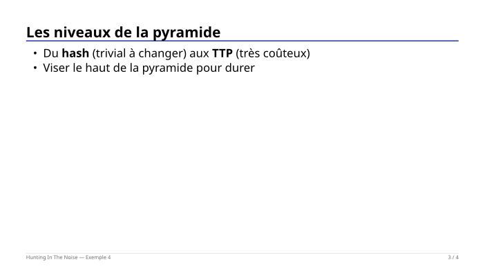<br>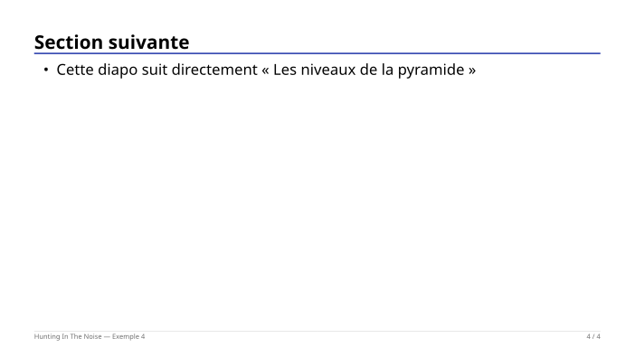 |

**Site :**

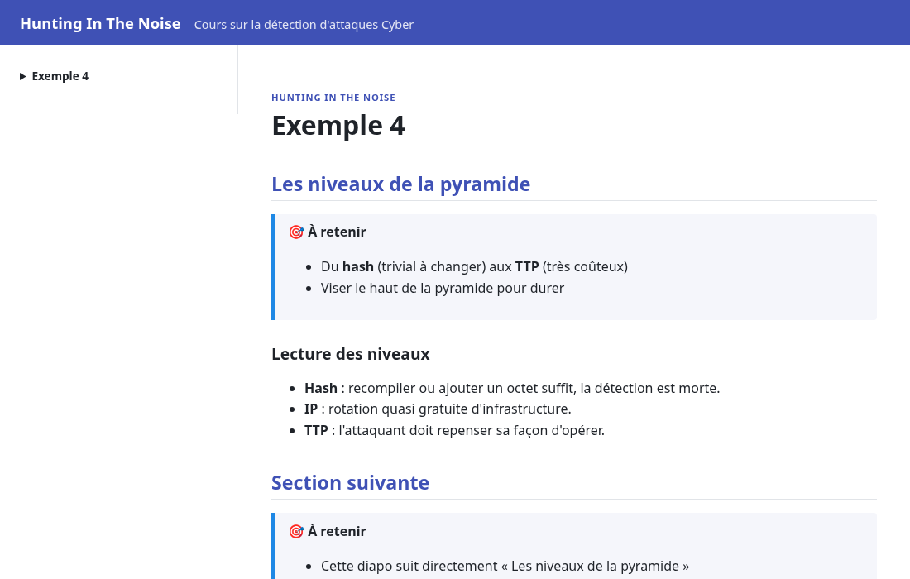

**Notes de l'orateur** de la diapo « Les niveaux de la pyramide » :

```markdown
Lecture des niveaux

- **Hash** : recompiler ou ajouter un octet suffit, la détection est morte.
- **IP** : rotation quasi gratuite d'infrastructure.
- **TTP** : l'attaquant doit repenser sa façon d'opérer.
```

---

## 5. `#ajuster` : faire tenir une diapo trop pleine

Quand le contenu d'une diapo dépasse la place disponible, il **continue sur la
diapo suivante**, titrée « (suite) ». Un tableau qui tient sur une diapo n'est
jamais coupé : il passe **en entier** à la diapo suivante. `#ajuster[…]`
réduit la taille du texte (par paliers de 5 %, jusqu'à 60 %) pour que le tout
tienne sur une seule diapo. Il n'a **aucun effet en A4 et sur le site**.

### 5.1 Sans `#ajuster` : la diapo déborde

Source : [manuel/exemples/05-ajuster-sans.typ](manuel/exemples/05-ajuster-sans.typ)

```typst
== 😈 Augmenter le coût pour l'attaquant

#synthese[
  - Pyramide de la douleur (David Bianco, 2013)
  - Tous les indicateurs ne se valent pas
]

==== Les six niveaux

Du plus douloureux (sommet) au plus indolore (base) :

#table(
  columns: (5fr, 7fr, auto, 6fr),
  table.header([Niveau], [Indicateur], [Douleur], [Ce que doit faire l'attaquant]),
  [*TTP*], [Tactiques, techniques, procédures], [Très douloureux], [Repenser toute sa méthodologie],
  … (6 lignes)
)
```

| Diapo 1 | Diapo 2 « (suite) » |
|---|---|
| 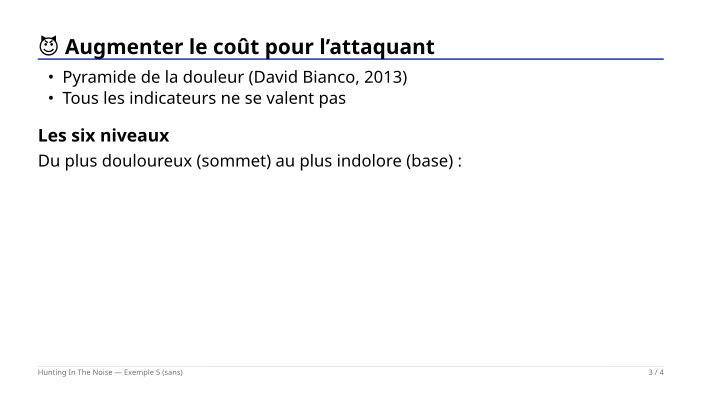 | 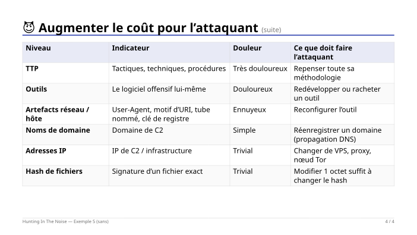 |

Le tableau ne tient pas sous les puces : il part seul sur une diapo « (suite) ».

### 5.2 Avec `#ajuster` autour de **tout** le contenu de la diapo ✅

Source : [manuel/exemples/05-ajuster-avec.typ](manuel/exemples/05-ajuster-avec.typ)

```typst
== 😈 Augmenter le coût pour l'attaquant

#ajuster[
#synthese[
  - Pyramide de la douleur (David Bianco, 2013)
  - Tous les indicateurs ne se valent pas
]

==== Les six niveaux

Du plus douloureux (sommet) au plus indolore (base) :

#table(…)
]
```

| Slides : une seule diapo, texte réduit | A4 : inchangé |
|---|---|
| 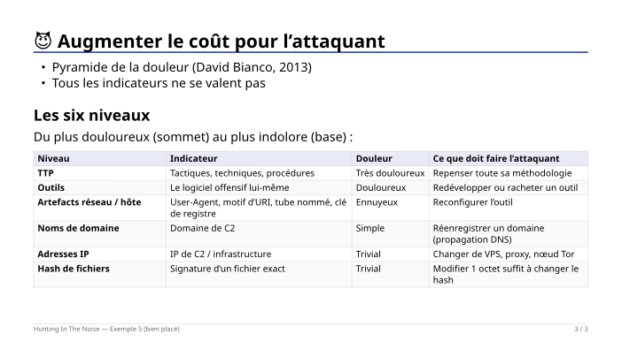 | 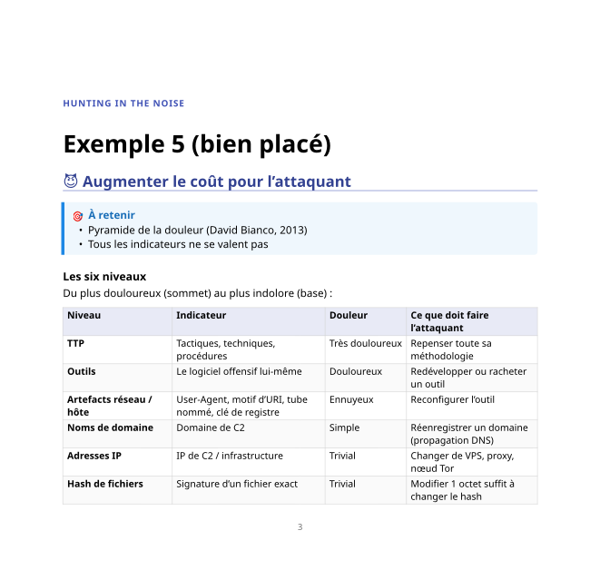 |

**Site (inchangé) :**

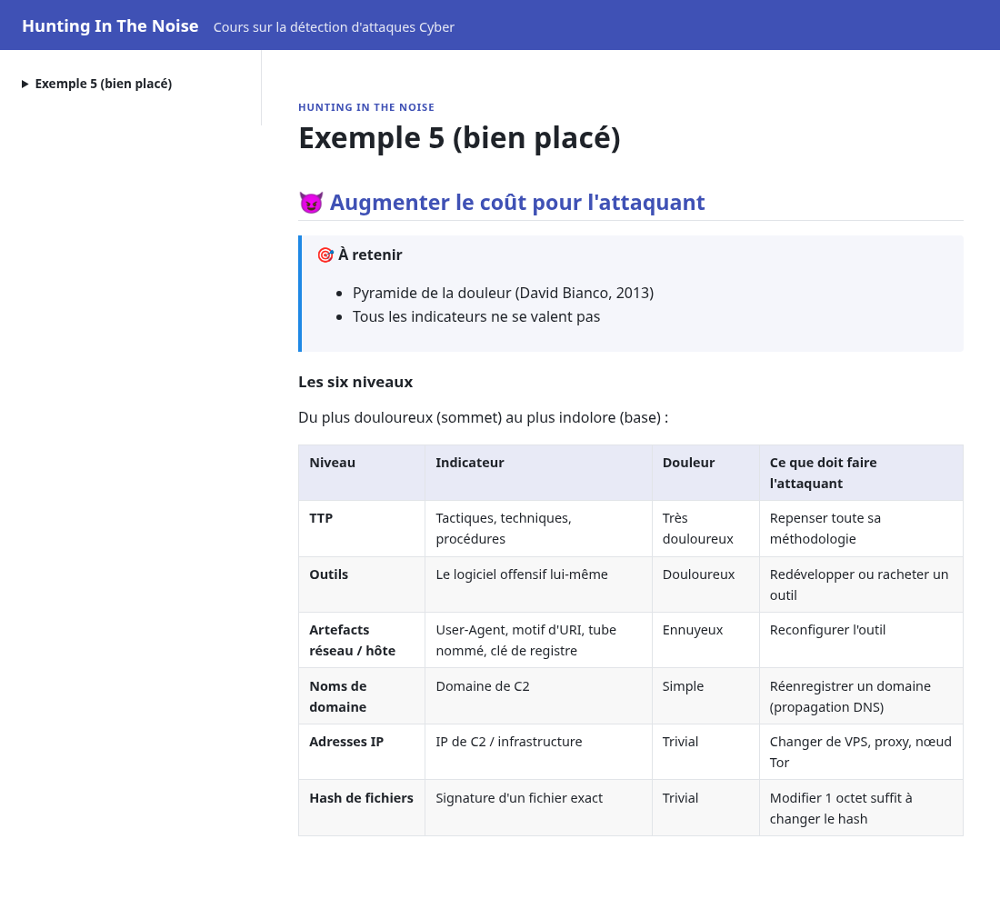

### 5.3 Piège : `#ajuster` placé après un autre contenu ❌

Source : [manuel/exemples/05-ajuster-piege.typ](manuel/exemples/05-ajuster-piege.typ)

```typst
#synthese[ … ]

==== Les six niveaux

#ajuster[
Du plus douloureux (sommet) au plus indolore (base) :

#table(…)
]
```

| Diapo 1 | Diapo 2 « (suite) » : rien n'a été réduit |
|---|---|
| 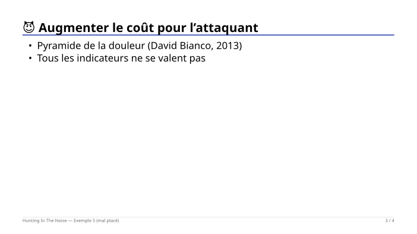 | 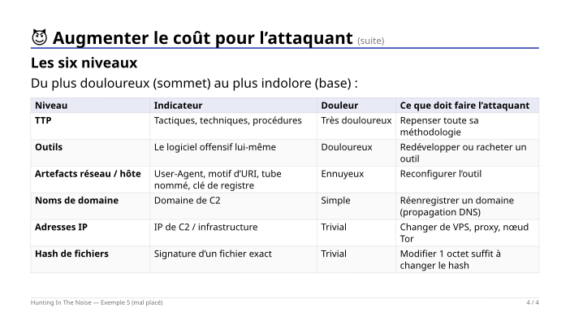 |

Le bloc `#ajuster` est insécable : s'il ne tient pas à 100 % sous la
synthèse, Typst le repousse sur la diapo suivante, où il a toute la place… et
n'a donc plus besoin d'être réduit. Résultat identique au cas « sans ».

**Règles pour `#ajuster` :**

- Il doit **commencer en haut de la diapo** : l'ouvrir juste après le titre
  `==`/`===` et y mettre tout le contenu de la diapo.
- Le minimum est réglable : `#ajuster(minimum: 70%)[…]` (par défaut 60 %).
  Si même au minimum ça ne tient pas, le contenu déborde quand même :
  il faut alors condenser (`#synthese` / `#developpement`) ou couper la
  section en deux titres.
- Il n'affecte pas le contenu au-delà du bloc : ne pas y mettre plus que ce qui
  doit tenir sur la diapo.

---

## 6. `#question`, `#reponse`, `#details`

Les questions 🧩 posées au groupe ont un rendu propre à chaque cible. On les
laisse **toujours hors** de `#developpement` (sinon elles deviendraient du
texte de note).

Source : [manuel/exemples/06-questions.typ](manuel/exemples/06-questions.typ)

```typst
== Questions de positionnement

#question[
  🧩 *1.* Qu'est-ce que le _dwell time_, et pourquoi cherche-t-on à le réduire ?
][
  C'est la durée pendant laquelle l'attaquant est présent dans le SI sans
  être détecté. Plus elle est courte, moins il progresse dans la kill chain.
]

#question[
  🧩 *2.* Le MTTD (Mean Time To Detect) mesure :

  a) Le temps moyen de réponse à un incident \
  b) Le temps moyen de détection d'un incident \
  c) Le temps moyen de remédiation
][
  *b)*, c'est la moyenne du dwell time sur l'ensemble des incidents.
]

#question[
  🧩 *3.* Question ouverte, sans réponse fournie : quelles sources de logs
  avez-vous dans votre SI ?
]

== Réponse et détails isolés

Un `#reponse` ou un `#details` peut aussi s'utiliser seul :

#reponse[Ceci est une réponse isolée (sans question).]

#details("💡 Pour aller plus loin : le MTTR")[
  Le MTTR (Mean Time To Respond) complète le MTTD : il mesure le temps entre
  la détection et la remédiation.
]
```

Syntaxe : `#question[énoncé][réponse]`. Le second crochet est facultatif
(question 3 : pas de réponse).

### 6.1 A4 : les réponses dans un corrigé en fin de chapitre

| Page des questions | Page « Corrigés » (fin du chapitre) |
|---|---|
| 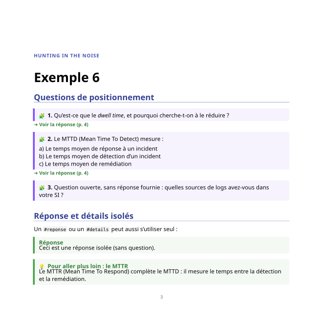 |  |

- Sous chaque question qui a une réponse : un lien **« ➜ Voir la réponse
  (p. 4) »**. Le lecteur ne voit pas la réponse en lisant la question.
- À la fin du chapitre, une page **« Corrigés »**, classée par section,
  numérotée comme les questions de la section (« Réponse 1 », « Réponse 2 »),
  avec un lien **« ← Retour à la question (p. 3) »**.
- La question 3 (sans réponse) n'a ni lien ni corrigé.
- `#reponse` et `#details` **isolés** ne vont pas au corrigé : ils restent sur
  place, dépliés (encadré vert).

> Si on compile un chapitre seul (prévisualisation d'un fichier `cours/…`
> sans passer par `main.typ`), le corrigé n'est pas généré : la réponse
> s'affiche alors sous la question.

### 6.2 Slides : diapo question, puis diapo question + réponse

Chaque question avec réponse donne **deux diapos identiques**, la seconde avec
la réponse en plus : en passant de l'une à l'autre, la réponse « apparaît ».

| Diapo 3 : question 1 | Diapo 4 : question 1 + réponse |
|---|---|
| 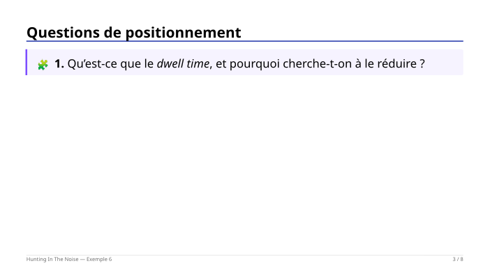 | 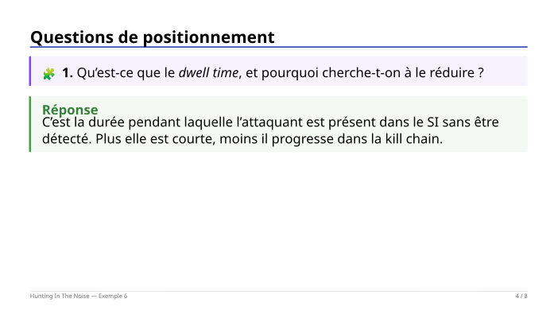 |
| **Diapo 5 : question 2** | **Diapo 6 : question 2 + réponse** |
| 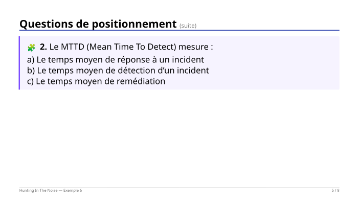 | 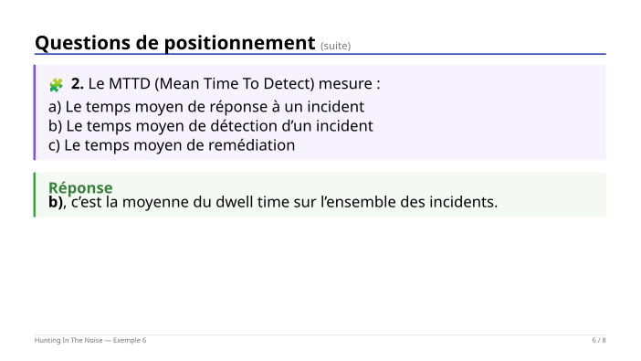 |
| **Diapo 7 : question 3 (sans réponse)** | **Diapo 8 : `#reponse` / `#details` isolés** |
| 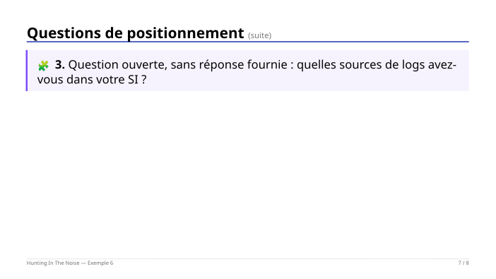 | 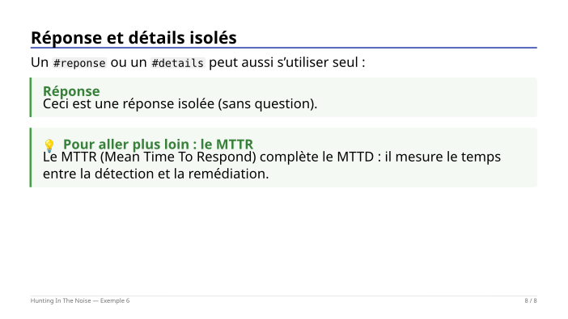 |

- **Une question par diapo** : chaque question ouvre sa propre diapo (titrée
  « (suite) » à partir de la deuxième). La première reste sur la diapo du titre.
- Une question **sans réponse** n'occupe qu'une diapo.
- `#reponse` et `#details` isolés sont affichés dépliés, sur la diapo courante.

### 6.3 Site : réponses repliées

| Repliées (à l'ouverture de la page) | Dépliées (après clic sur « Réponse ») |
|---|---|
| 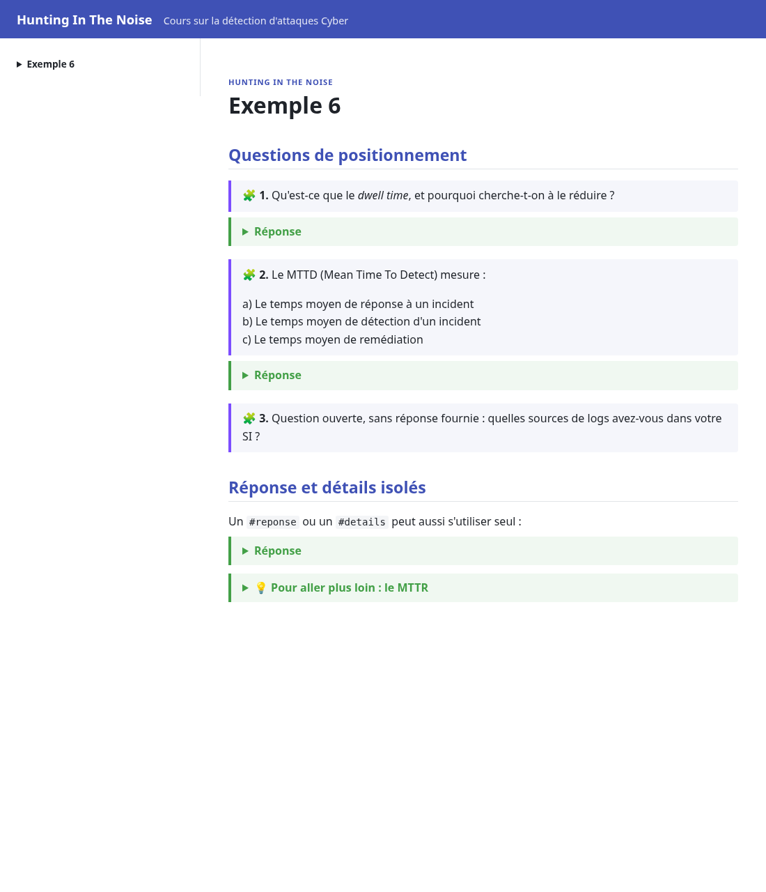 |  |

- Chaque réponse est un bloc `<details>` replié, **juste sous** sa question ;
  un clic sur « ▶ Réponse » la déplie.
- `#details("Titre")[…]` donne le même bloc repliable, avec le titre choisi
  (ici « 💡 Pour aller plus loin : le MTTR »).

### Récapitulatif

| | A4 | Slides | Site |
|---|---|---|---|
| `#question[Q][R]` | Q + lien « Voir la réponse » ; R au corrigé de fin de chapitre | diapo Q, puis diapo Q + R | Q + R repliée dessous |
| `#question[Q]` | Q seule | une diapo Q | Q seule |
| `#reponse[R]` | encadré vert « Réponse », déplié | idem | « ▶ Réponse » repliable |
| `#details("T")[…]` | encadré vert titré « T », déplié | idem | « ▶ T » repliable |

---

## 7. Notes de l'orateur : où les lire

Tout `#developpement` rencontré sur une diapo est converti en texte
(Markdown léger : gras, italique, code, listes) et attaché à **cette diapo**.
Plusieurs `#developpement` sur la même diapo sont mis bout à bout.

`make slides` écrit les notes dans
`target/hunting-in-the-noise-slides.pdfpc`, à côté du PDF. Les visionneuses
[pdfpc](https://pdfpc.github.io/) et [pympress](https://github.com/Cimbali/pympress)
le chargent automatiquement (écran public : la diapo ; écran présentateur : la
diapo, la suivante et les notes) :

```bash
pdfpc target/hunting-in-the-noise-slides.pdf
pympress target/hunting-in-the-noise-slides.pdf
```

Pour lire les notes sans visionneuse (vérifier ce qui est parti en note) :

```bash
typst query --root docs --input cible=slides docs/main.typ "<note-orateur>" --field value
```

**Ce qui ne passe pas dans les notes** : images, schémas, tableaux, mise en
forme des encadrés (le texte d'un `#note` est gardé, pas son cadre). Un tableau
court ou un schéma est déjà synthétique : le laisser **hors** de
`#developpement` pour qu'il reste sur la diapo. `#voir(…)` fonctionne : le
texte du lien est repris dans la note.

---

## 8. Aide-mémoire : quel bloc choisir ?

| Je veux… | J'écris |
|---|---|
| le même contenu partout (tableau court, schéma, phrase-clé) | rien, texte normal |
| des puces sur la diapo, le texte complet dans le support | `#synthese[puces]` + `#developpement[texte]` |
| le texte complet dans le support, rien sur la diapo, mais le formateur doit l'avoir | `#developpement[texte]` |
| une accroche **seulement** sur la diapo | `#diapo[…]` |
| remplacer un texte par une version courte sans casser la mise en page | `#selon(slides: [court])[long]` |
| une sous-section entière seulement dans le support | `#developpement[=== Titre … ]` |
| faire tenir une diapo qui déborde un peu | `#ajuster[tout le contenu de la diapo]` juste après le titre |
| poser une question au groupe | `#question[🧩 énoncé][réponse]`, hors de `#developpement` |
| un encart repliable sur le site (solution, approfondissement) | `#details("Titre")[…]` |

**Repères pour les slides :**

- Une diapo par titre de niveau 1 à 3 (`=`, `==`, `===`). Un titre de niveau 4
  (`====`) reste sur la diapo en cours.
- Une synthèse de 3 à 5 puces courtes tient sur une diapo. Au-delà, le contenu
  continue sur une diapo « (suite) ».
- Sans aucun de ces blocs, un chapitre s'affiche à l'identique sur les trois
  cibles : on peut condenser un chapitre progressivement.
- Exemple réel complet : [cours/02-bonne-detection.typ](cours/02-bonne-detection.typ).

---

## 9. Thèmes visuels : changer l'habillage

Les blocs ci-dessus décident **quoi** afficher sur chaque cible. Le thème
décide **comment** c'est habillé : couleurs, polices, décors. Le contenu des
chapitres ne change pas, on choisit le thème à la compilation :

```bash
make slides THEME=soc            # diapos avec le thème « SOC de nuit »
make a4 THEME=crise              # A4 avec le thème « Cellule de crise »
make all THEME=tlp               # les trois cibles avec le même thème
```

Sans `THEME`, c'est le thème **classique**, celui de toutes les captures de
ce manuel.

| Thème | Ambiance | Diapo de contenu |
|---|---|---|
| `classique` | indigo, sobre (thème d'origine) | 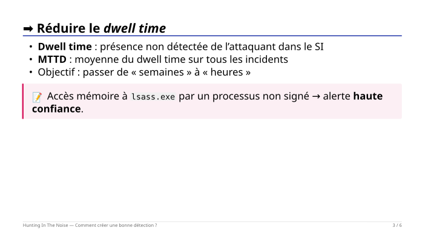 |
| `soc` | 🖥️ SOC de nuit : console sombre, vert phosphore, invite `>` et curseur | 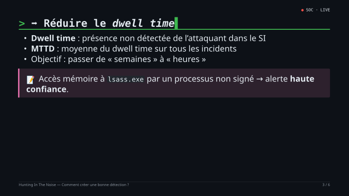 |
| `crise` | 🚨 Cellule de crise : bande de signalisation, rouge alerte, capitales | 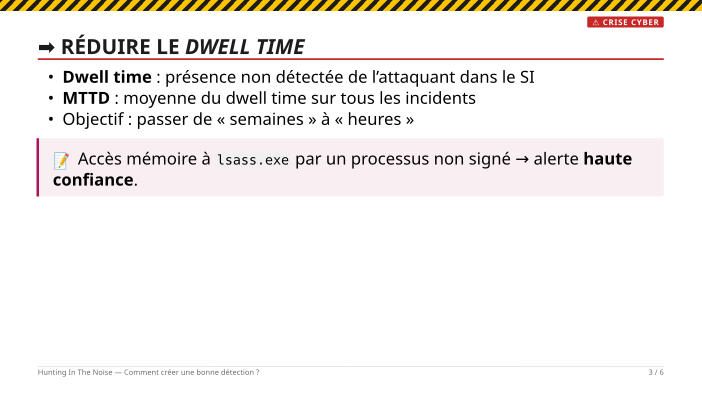 |
| `tlp` | 🗂️ Rapport d'incident : papier, machine à écrire, marquage `TLP:CLEAR` | 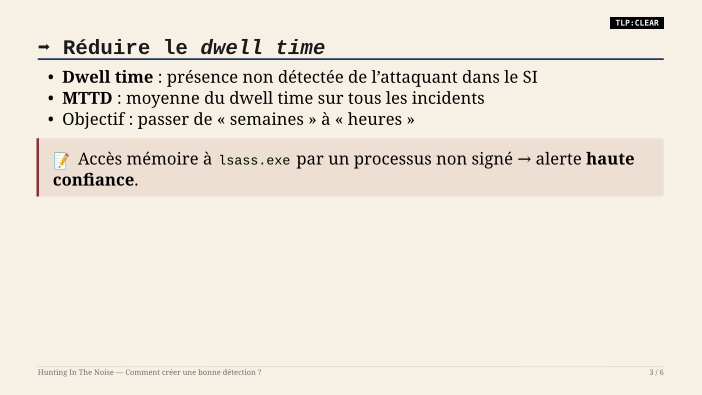 |
| `bouclier` | 🛡️ Blue Team : bandeau marine, bleu électrique | 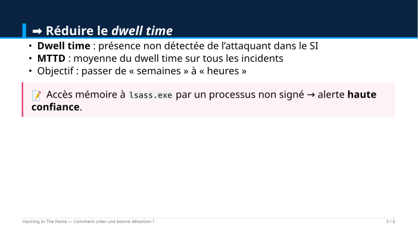 |
| `neon` | 😈 Red Team néon : violet nuit, magenta et cyan, titres « glitch » | 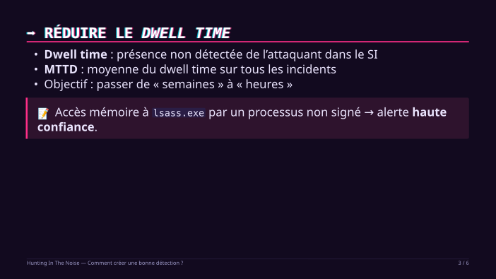 |

À savoir :

- Avec `soc` et `neon`, les diapos et le site sont **sombres**, mais l'A4 reste
  clair (il est fait pour être imprimé).
- Les polices à chasse fixe (`soc`, `tlp`, `neon`) sont plus larges : une diapo
  pleine peut déborder sur une « (suite) » qui n'existe pas en classique.
  Vérifiez avec le thème que vous projetterez réellement.
- Les blocs gardent leur rôle d'un thème à l'autre : `#synthese`, `#question`,
  etc. changent de couleurs, jamais de comportement.

**Pour aller plus loin** : [manuel/themes.md](manuel/themes.md) montre chaque
thème en entier (couverture, chapitre, tableau, question, A4, site) et
explique comment créer ou retoucher un thème dans
[lib/theme.typ](lib/theme.typ) et [lib/site.css](lib/site.css).
