# Writing guide: one source, three renderings

This guide shows, with examples and screenshots, how a single Typst chapter
produces **three different renderings**:

| Target | Command | For whom |
|---|---|---|
| **A4** (PDF) | `make a4` | the reader: full text, to print or read on their own |
| **Site** (HTML) | `make site` | the online reader: full text, collapsible answers |
| **Slides** (16:9 PDF) | `make slides` | the trainer: short slides + **speaker notes** |

Principle: **the A4 and the site are detailed, the slides are concise.**
You write the full text only once, then mark what goes on the slide
with a few blocks:

| Block | A4 / site | Slides |
|---|---|---|
| (normal text, no block) | displayed | displayed |
| `#synthese[…]` | blue "🎯 À retenir" (key takeaways) box | **slide content** |
| `#developpement[…]` | normal text | **speaker note** (nothing on the slide) |
| `#diapo[…]` | absent | displayed |
| `#selon(slides: [short])[long]` | long version | short version |
| `#ajuster[…]` | unchanged | text shrunk (down to 60%) to fit on the slide |
| `#question[prompt][answer]` | A4: link to an answer key at the end of the chapter; site: collapsed answer | one question slide, then the same slide with the answer |

Contents:

1. [`#synthese` + `#developpement`: the standard section](#1-synthese--developpement-the-standard-section)
2. [`#diapo`: a line for the slide only](#2-diapo-a-line-for-the-slide-only)
3. [`#selon`: short version of an in-place block](#3-selon-short-version-of-an-in-place-block)
4. [Heading inside a `#developpement`: written-only subsection](#4-heading-inside-a-developpement-written-only-subsection)
5. [`#ajuster`: fitting an overfull slide](#5-ajuster-fitting-an-overfull-slide)
6. [`#question`, `#reponse`, `#details`](#6-question-reponse-details)
7. [Speaker notes: where to read them](#7-speaker-notes-where-to-read-them)
8. [Cheat sheet: which block to use?](#8-cheat-sheet-which-block-to-use)
9. [Visual themes: changing the look](#9-visual-themes-changing-the-look)

> **About the screenshots.** They are produced from the small files
> in [manuel/exemples/](manuel/exemples/), compiled as-is with the course
> theme, by `bash docs/manuel/captures.sh` (rerun it if `lib/theme.typ`
> changes). The only difference from the real course: A4 pages are cropped to
> their content (the `#set page(height: auto) if est-a4` line in the examples),
> so as not to show a half-blank page. The title slide, the table of contents
> and the chapter slide are not shown.

---

## 1. `#synthese` + `#developpement`: the standard section

This is the most common case: a few bullets that summarize (the slide), then
the full text (the written material).

Source: [manuel/exemples/01-synthese-developpement.typ](manuel/exemples/01-synthese-developpement.typ)

```typst
== ➡️ Réduire le _dwell time_

#synthese[
  - *Dwell time* : présence non détectée de l'attaquant dans le SI
  - *MTTD* : moyenne du dwell time sur tous les incidents
  - Objectif : passer de « semaines » à « heures »
]

#developpement[
  - *Dwell time* = durée pendant laquelle l'attaquant est présent dans le SI
    sans être détecté (de la compromission initiale à la détection).
  - Le *MTTD (Mean Time To Detect)* est sa moyenne sur l'ensemble des incidents.

  Plus le dwell time est court, moins l'attaquant a le temps de progresser.

  #note[C'est la métrique de résultat d'un programme de détection.]
]
```

| A4 | Slides |
|---|---|
| 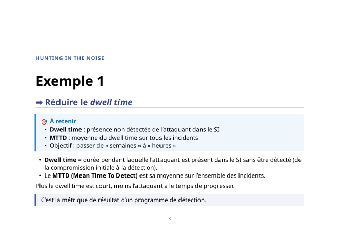 | 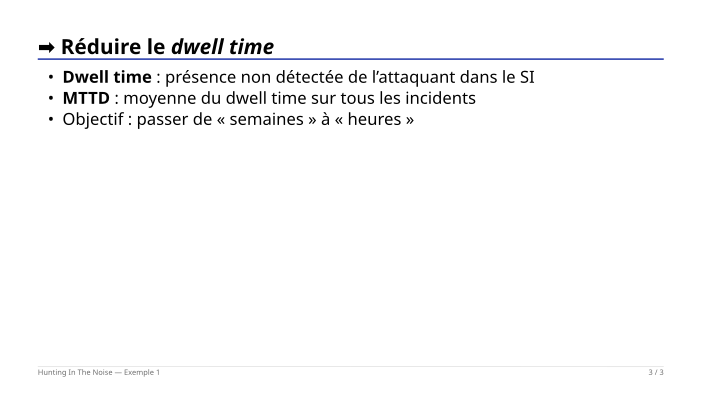 |

**Site:**

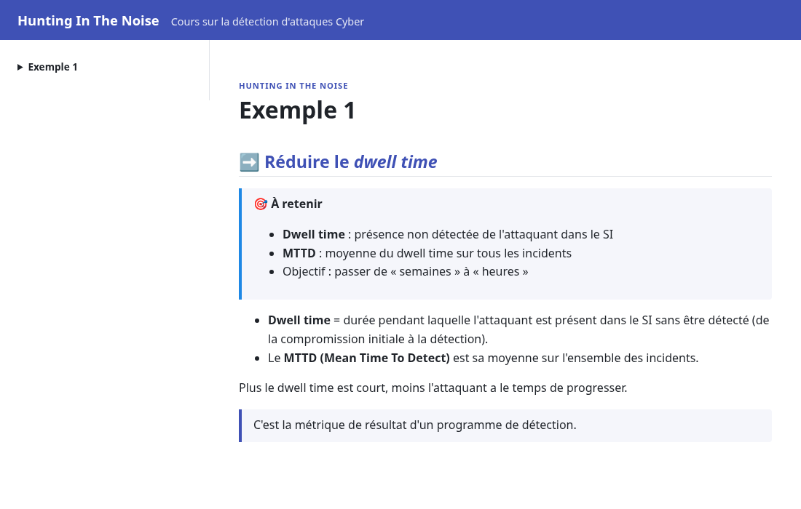

**What happens:**

- **A4 and site**: the summary becomes the blue "🎯 À retenir" box, followed
  by the text of the `#developpement`, displayed normally (bullets, paragraph,
  `#note` box).
- **Slides**: the slide shows **only** the 3 bullets of the summary. The
  `#developpement` disappears from the slide and becomes that slide's
  **speaker note** (see [§ 7](#7-speaker-notes-where-to-read-them)):

  ```markdown
  - **Dwell time** = durée pendant laquelle l'attaquant est présent dans le SI sans être détecté (de la compromission initiale à la détection).
  - Le **MTTD (Mean Time To Detect)** est sa moyenne sur l'ensemble des incidents.

  Plus le dwell time est court, moins l'attaquant a le temps de progresser.

  C'est la métrique de résultat d'un programme de détection.
  ```

  The `#note` frame is lost (the note is plain text), but its text
  is kept.

---

## 2. `#diapo`: a line for the slide only

When the development goes into the notes but the slide must keep the main
idea, write it in `#diapo`: it appears **only** in the slides.

Source: [manuel/exemples/02-diapo.typ](manuel/exemples/02-diapo.typ)

```typst
== Prioriser les alertes

Une détection « parfaite » sur le papier mais qui produit 95 % de faux
positifs a un coût opérationnel qui dépasse sa valeur 🤯

#diapo[
  *Prioriser* : score de risque = confiance × impact (_risk-based alerting_)
]

#developpement[#note[
  Prioriser les alertes de l'organisation
  - _Confiance_ : probabilité que ce soit réellement malveillant.
  - _Impact potentiel_ : gravité si c'est vrai, pondérée par la criticité de
    l'actif touché (un DC vs un poste de test).
]]
```

| A4 | Slides |
|---|---|
| 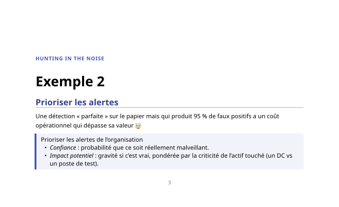 | 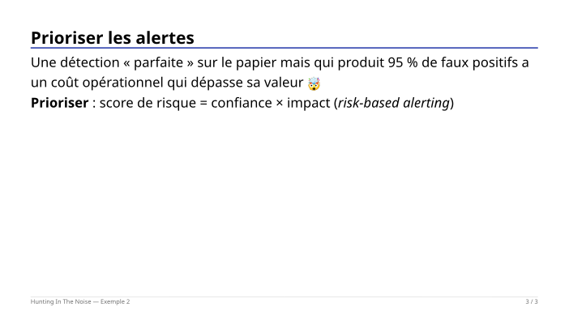 |

**Site:**

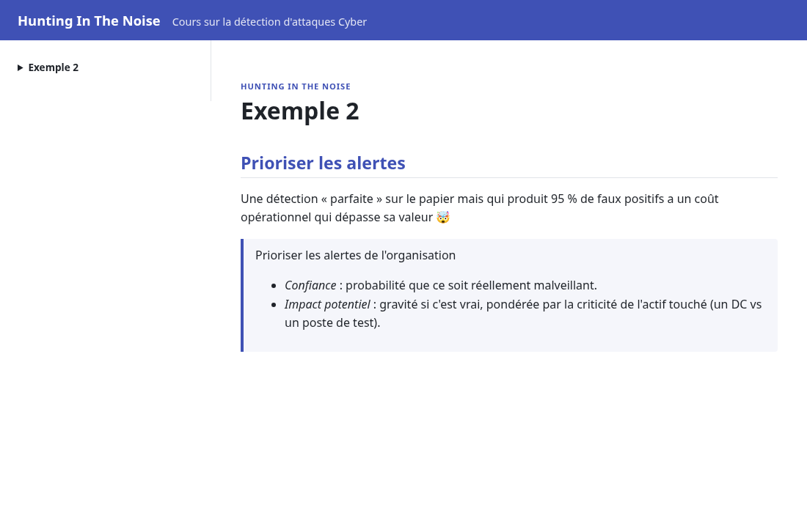

**What happens:**

- The paragraph "Une détection parfaite…" is outside any block: it is
  **identical everywhere**.
- The line "**Prioriser**: score de risque…" exists **only on the slide**.
- The `#note` box exists **only in the A4 and on the site**; in the slides,
  its text is in the speaker notes:

  ```markdown
  Prioriser les alertes de l'organisation
  - _Confiance_ : probabilité que ce soit réellement malveillant.
  - _Impact potentiel_ : gravité si c'est vrai, pondérée par la criticité de l'actif touché (un DC vs un poste de test).
  ```

> `#diapo` is the opposite of `#developpement`: one exists only in the slides,
> the other everywhere except on the slide.

---

## 3. `#selon`: short version of an in-place block

`#synthese` / `#developpement` stack their content. When the text sits
inside a layout (here two columns, text | image), you want to **replace**
the long text with a short one without touching the rest: that is `#selon`.

Source: [manuel/exemples/03-selon.typ](manuel/exemples/03-selon.typ)

```typst
== 😈 Augmenter le coût pour l'attaquant

#colonnes[
  #selon(slides: [
    🧐 *Le défenseur doit maximiser le coût de contournement.*

    - tous les indicateurs ne se valent pas ;
    - la valeur vient de ceux qui sont coûteux à modifier.
  ])[
    🧐 L'adversaire doit contourner la détection (identifier ce qui est
    difficile à changer pour lui) : *le défenseur doit donc maximiser ce coût !*

    Créée par *David Bianco en 2013*, la Pyramide de la douleur classe …

    - Tous les indicateurs ne se valent pas (…)
    - La vraie valeur défensive vient des indicateurs coûteux à modifier.
  ]
][
  #illustration("/images/pyramide-de-la-douleur.svg", alt: "La Pyramide de la douleur", largeur: 90%)
]
```

| A4 (long version) | Slides (short version) |
|---|---|
| 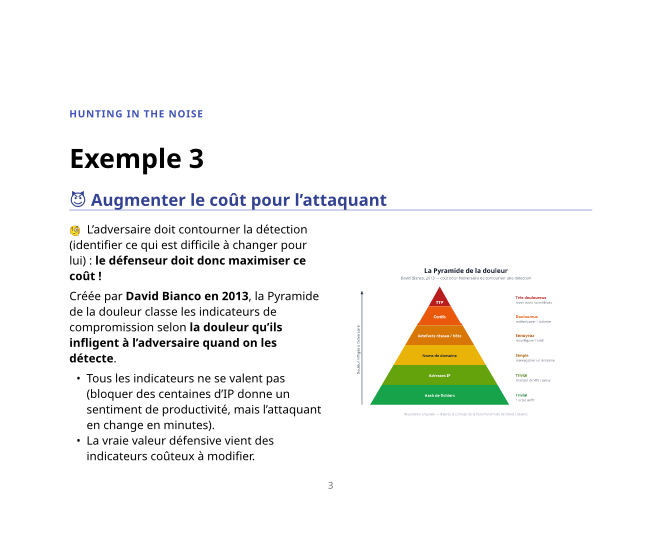 | 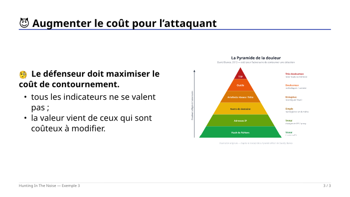 |

**Site (long version):**

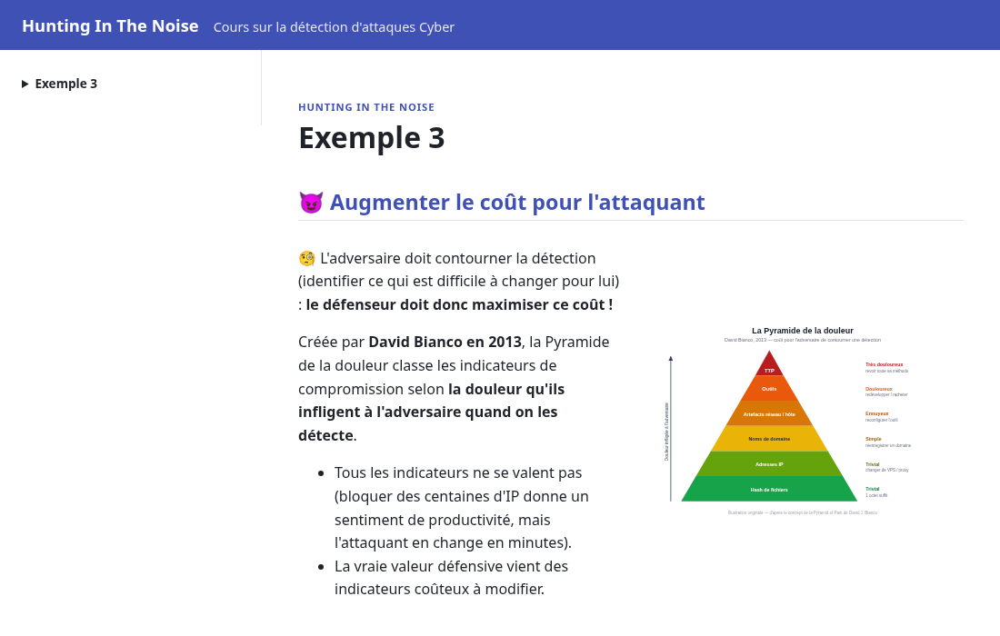

**What happens:** the left column contains the long text in the A4 and
on the site, and the short text (the `slides:` argument) on the slide. The
image stays on the right everywhere.

> Unlike `#developpement`, the long version of a `#selon` does **not** go
> into the speaker notes. If the trainer needs it, add a
> `#developpement[…]` next to it.

---

## 4. Heading inside a `#developpement`: written-only subsection

In the slides, **every level 1 to 3 heading starts a new slide**.
A heading placed **inside** a `#developpement` does not exist in the slides: it
therefore creates no slide, and its text (heading included) becomes the note
of the previous slide.

Source: [manuel/exemples/04-sous-section-ecrite.typ](manuel/exemples/04-sous-section-ecrite.typ)

```typst
== Les niveaux de la pyramide

#synthese[
  - Du *hash* (trivial à changer) aux *TTP* (très coûteux)
  - Viser le haut de la pyramide pour durer
]

#developpement[
=== Lecture des niveaux

- *Hash* : recompiler ou ajouter un octet suffit, la détection est morte.
- *IP* : rotation quasi gratuite d'infrastructure.
- *TTP* : l'attaquant doit repenser sa façon d'opérer.
]

== Section suivante

#synthese[
  - Cette diapo suit directement « Les niveaux de la pyramide »
]
```

| A4: the "Lecture des niveaux" subsection is there | Slides: no "Lecture des niveaux" slide |
|---|---|
| 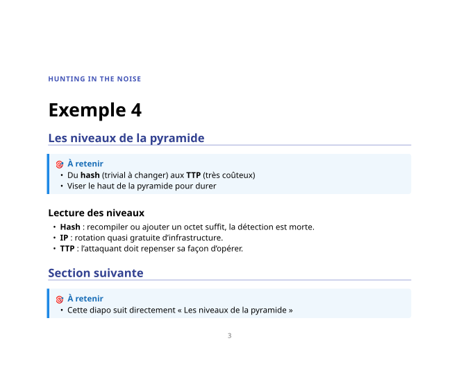 | 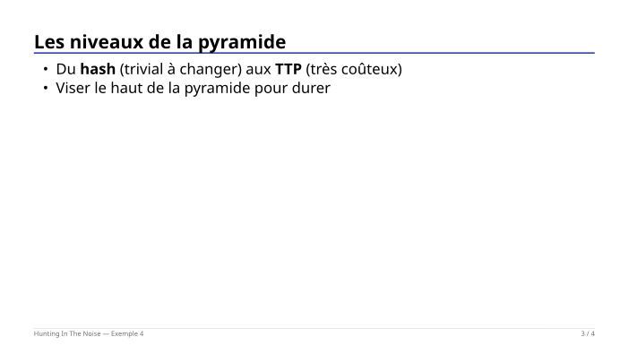<br>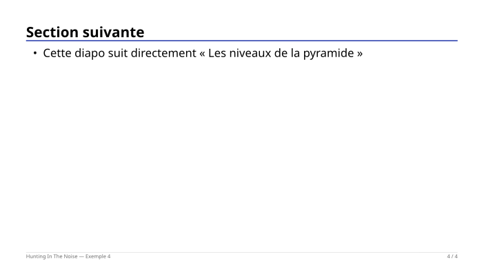 |

**Site:**

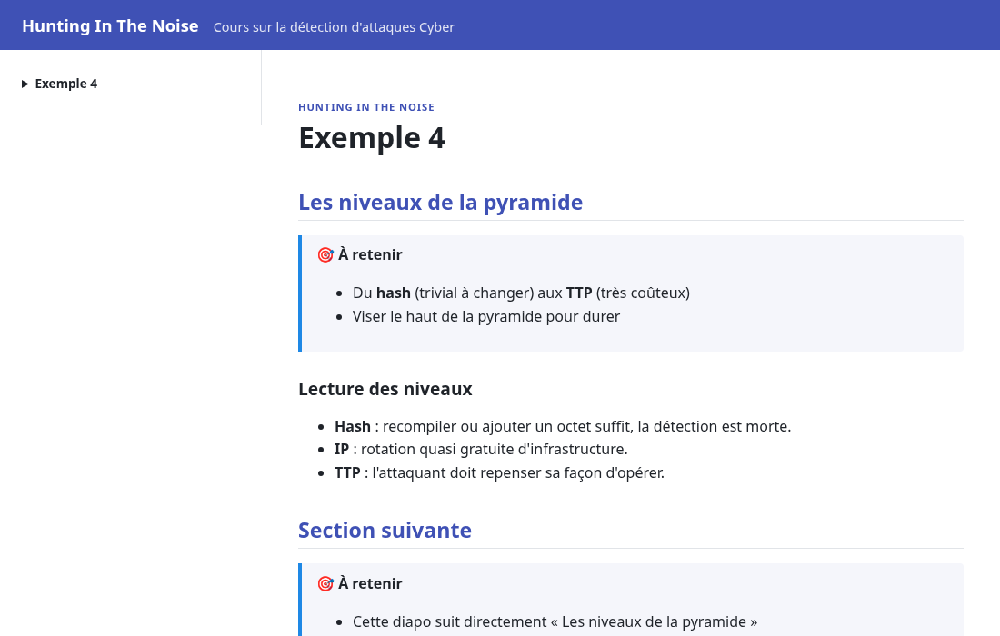

**Speaker notes** of the "Les niveaux de la pyramide" slide:

```markdown
Lecture des niveaux

- **Hash** : recompiler ou ajouter un octet suffit, la détection est morte.
- **IP** : rotation quasi gratuite d'infrastructure.
- **TTP** : l'attaquant doit repenser sa façon d'opérer.
```

---

## 5. `#ajuster`: fitting an overfull slide

When a slide's content exceeds the available space, it **continues on the
next slide**, titled "(suite)" (continued). A table that fits on one slide is
never split: it moves **as a whole** to the next slide. `#ajuster[…]`
shrinks the text size (in 5% steps, down to 60%) so that everything
fits on a single slide. It has **no effect in the A4 or on the site**.

### 5.1 Without `#ajuster`: the slide overflows

Source: [manuel/exemples/05-ajuster-sans.typ](manuel/exemples/05-ajuster-sans.typ)

```typst
== 😈 Augmenter le coût pour l'attaquant

#synthese[
  - Pyramide de la douleur (David Bianco, 2013)
  - Tous les indicateurs ne se valent pas
]

==== Les six niveaux

Du plus douloureux (sommet) au plus indolore (base) :

#table(
  columns: (5fr, 7fr, auto, 6fr),
  table.header([Niveau], [Indicateur], [Douleur], [Ce que doit faire l'attaquant]),
  [*TTP*], [Tactiques, techniques, procédures], [Très douloureux], [Repenser toute sa méthodologie],
  … (6 lignes)
)
```

| Slide 1 | Slide 2 "(suite)" |
|---|---|
| 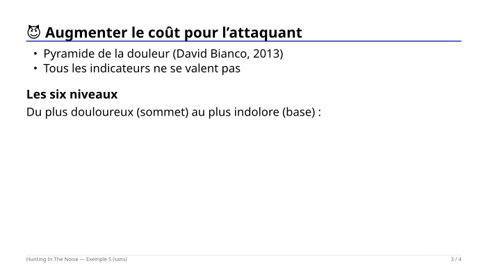 | 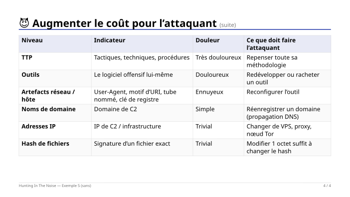 |

The table does not fit under the bullets: it moves on its own to a "(suite)" slide.

### 5.2 With `#ajuster` around **all** of the slide's content ✅

Source: [manuel/exemples/05-ajuster-avec.typ](manuel/exemples/05-ajuster-avec.typ)

```typst
== 😈 Augmenter le coût pour l'attaquant

#ajuster[
#synthese[
  - Pyramide de la douleur (David Bianco, 2013)
  - Tous les indicateurs ne se valent pas
]

==== Les six niveaux

Du plus douloureux (sommet) au plus indolore (base) :

#table(…)
]
```

| Slides: a single slide, shrunk text | A4: unchanged |
|---|---|
| 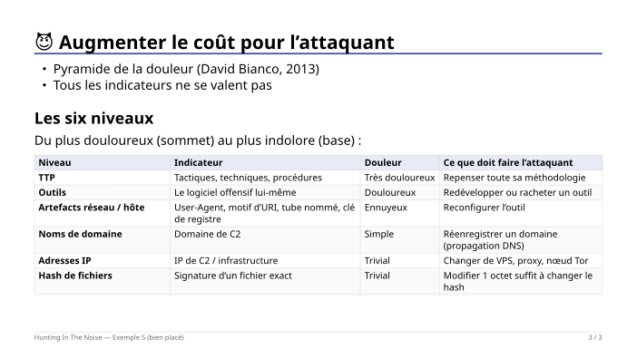 | 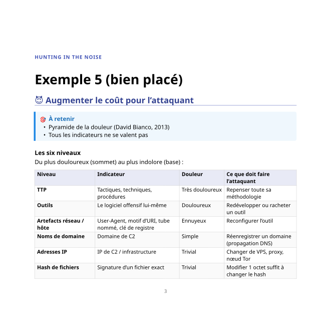 |

**Site (unchanged):**

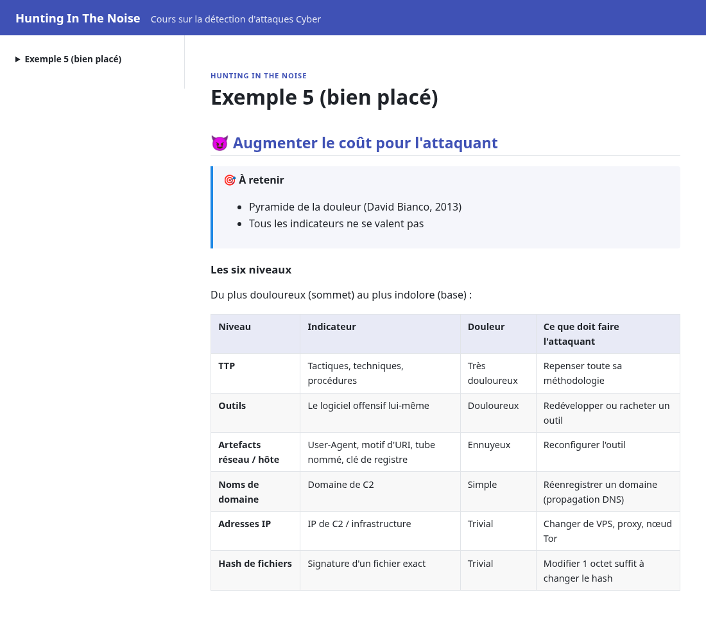

### 5.3 Pitfall: `#ajuster` placed after other content ❌

Source: [manuel/exemples/05-ajuster-piege.typ](manuel/exemples/05-ajuster-piege.typ)

```typst
#synthese[ … ]

==== Les six niveaux

#ajuster[
Du plus douloureux (sommet) au plus indolore (base) :

#table(…)
]
```

| Slide 1 | Slide 2 "(suite)": nothing was shrunk |
|---|---|
| 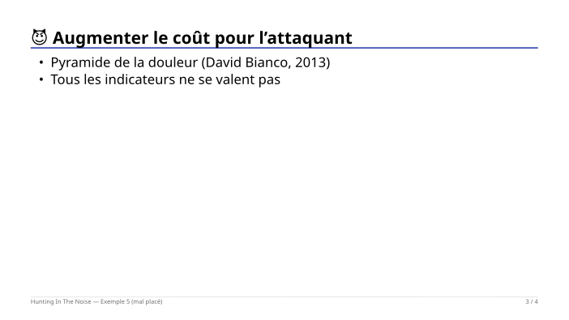 | 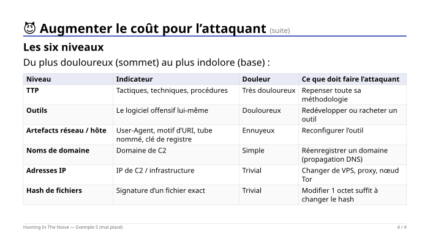 |

The `#ajuster` block cannot be split: if it does not fit at 100% under the
summary, Typst pushes it to the next slide, where it has all the room it needs…
and therefore no longer needs shrinking. The result is the same as the "without" case.

**Rules for `#ajuster`:**

- It must **start at the top of the slide**: open it right after the
  `==`/`===` heading and put all of the slide's content in it.
- The minimum is configurable: `#ajuster(minimum: 70%)[…]` (60% by default).
  If it still does not fit at the minimum, the content overflows anyway:
  you then need to condense it (`#synthese` / `#developpement`) or split the
  section under two headings.
- It does not affect content beyond the block: do not put more in it than what
  must fit on the slide.

---

## 6. `#question`, `#reponse`, `#details`

🧩 questions asked to the group have a rendering specific to each target. Always
keep them **outside** `#developpement` (otherwise they would become note
text).

Source: [manuel/exemples/06-questions.typ](manuel/exemples/06-questions.typ)

```typst
== Questions de positionnement

#question[
  🧩 *1.* Qu'est-ce que le _dwell time_, et pourquoi cherche-t-on à le réduire ?
][
  C'est la durée pendant laquelle l'attaquant est présent dans le SI sans
  être détecté. Plus elle est courte, moins il progresse dans la kill chain.
]

#question[
  🧩 *2.* Le MTTD (Mean Time To Detect) mesure :

  a) Le temps moyen de réponse à un incident \
  b) Le temps moyen de détection d'un incident \
  c) Le temps moyen de remédiation
][
  *b)*, c'est la moyenne du dwell time sur l'ensemble des incidents.
]

#question[
  🧩 *3.* Question ouverte, sans réponse fournie : quelles sources de logs
  avez-vous dans votre SI ?
]

== Réponse et détails isolés

Un `#reponse` ou un `#details` peut aussi s'utiliser seul :

#reponse[Ceci est une réponse isolée (sans question).]

#details("💡 Pour aller plus loin : le MTTR")[
  Le MTTR (Mean Time To Respond) complète le MTTD : il mesure le temps entre
  la détection et la remédiation.
]
```

Syntax: `#question[prompt][answer]`. The second bracket is optional
(question 3: no answer).

### 6.1 A4: answers in an answer key at the end of the chapter

| Questions page | "Corrigés" (answer key) page (end of chapter) |
|---|---|
| 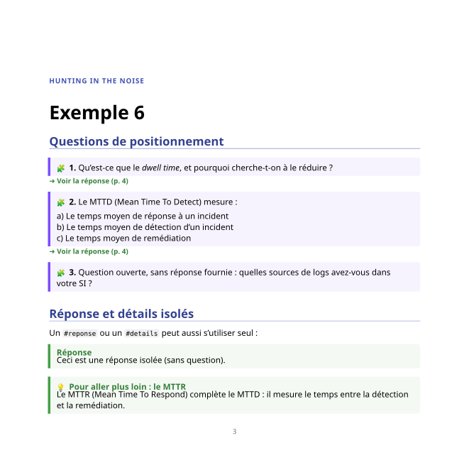 | 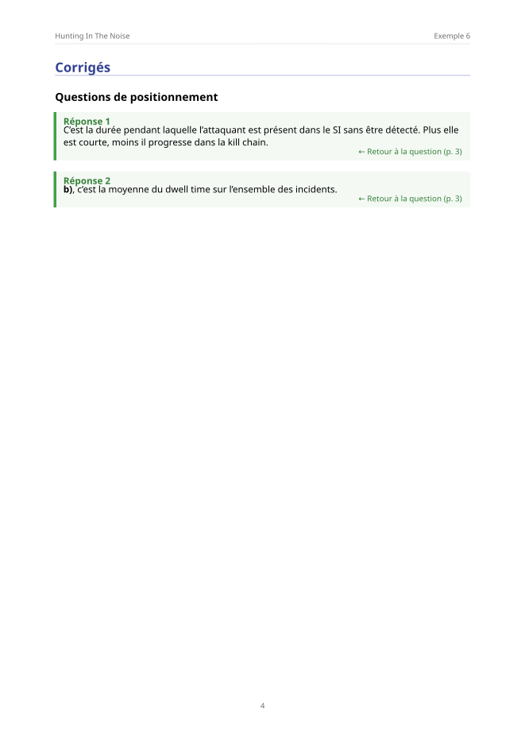 |

- Under each question that has an answer: a **"➜ Voir la réponse
  (p. 4)"** (see the answer) link. The reader does not see the answer while reading the question.
- At the end of the chapter, a **"Corrigés"** page, organized by section,
  numbered like the questions in the section ("Réponse 1", "Réponse 2"),
  with a **"← Retour à la question (p. 3)"** (back to the question) link.
- Question 3 (no answer) has neither a link nor an answer-key entry.
- **Standalone** `#reponse` and `#details` do not go to the answer key: they stay
  in place, expanded (green box).

> If you compile a chapter on its own (preview of a `cours/…` file
> without going through `main.typ`), the answer key is not generated: the answer
> is then displayed under the question.

### 6.2 Slides: question slide, then question + answer slide

Each question with an answer produces **two identical slides**, the second one with
the answer added: when moving from one to the other, the answer "appears".

| Slide 3: question 1 | Slide 4: question 1 + answer |
|---|---|
| 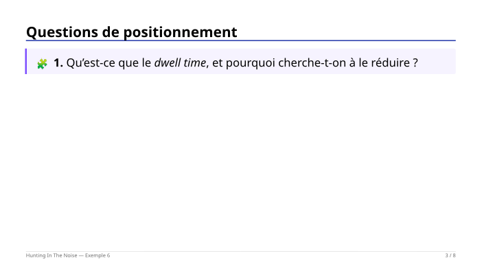 | 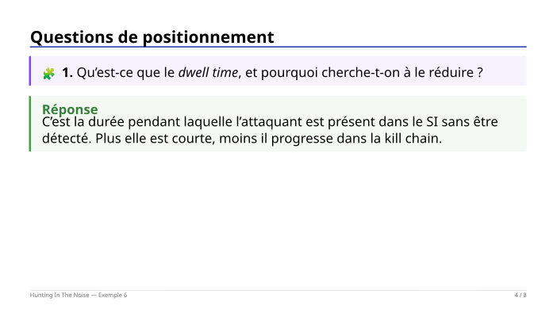 |
| **Slide 5: question 2** | **Slide 6: question 2 + answer** |
| 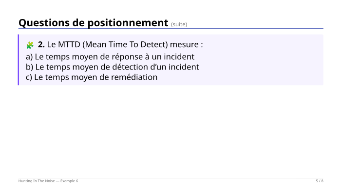 | 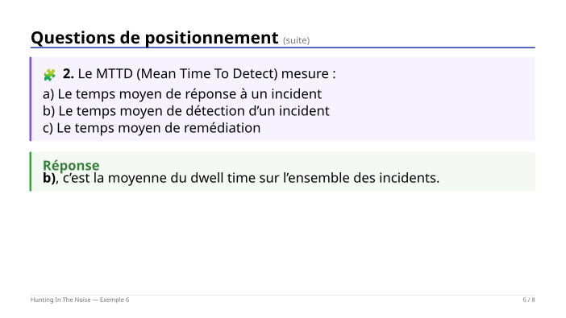 |
| **Slide 7: question 3 (no answer)** | **Slide 8: standalone `#reponse` / `#details`** |
| 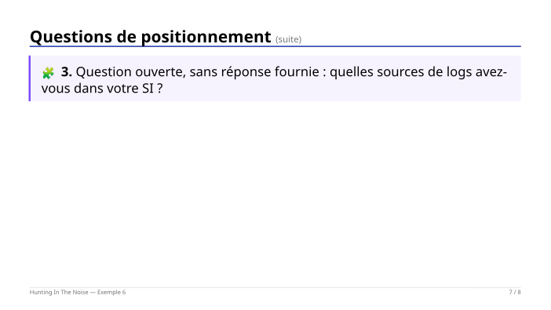 | 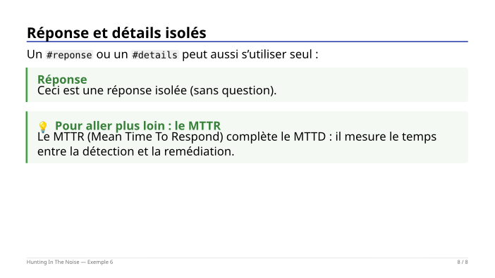 |

- **One question per slide**: each question opens its own slide (titled
  "(suite)" from the second one on). The first one stays on the heading's slide.
- A question **without an answer** takes up only one slide.
- Standalone `#reponse` and `#details` are displayed expanded, on the current slide.

### 6.3 Site: collapsed answers

| Collapsed (when the page opens) | Expanded (after clicking "Réponse") |
|---|---|
| 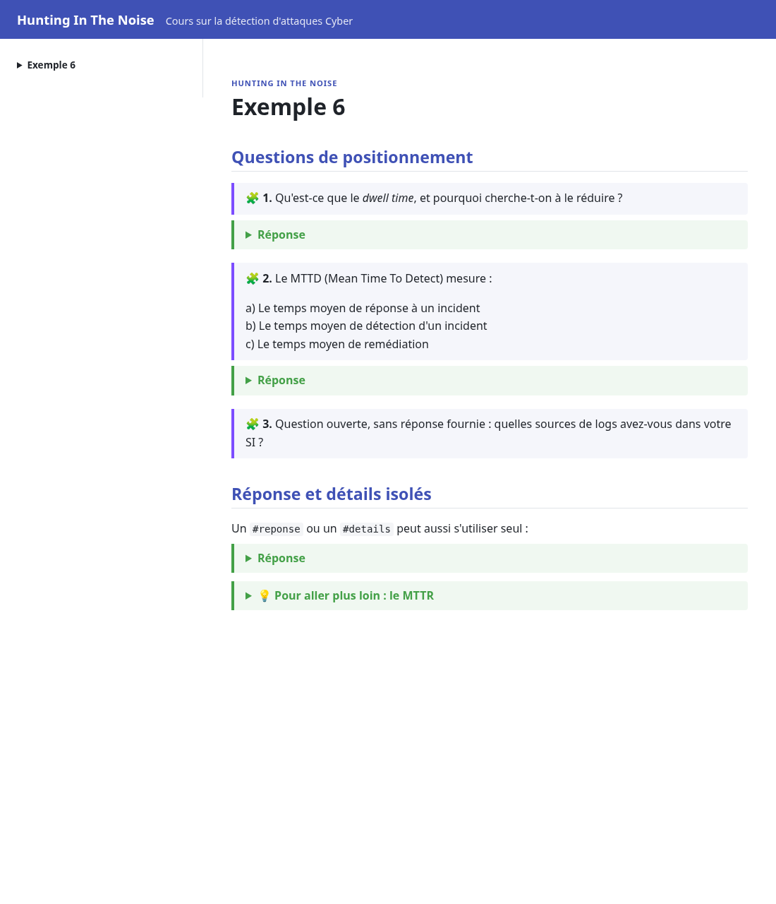 | 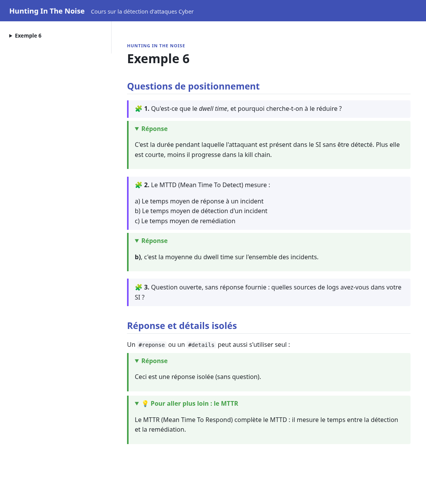 |

- Each answer is a collapsed `<details>` block, **right under** its question;
  clicking "▶ Réponse" expands it.
- `#details("Title")[…]` produces the same collapsible block, with the chosen title
  (here "💡 Pour aller plus loin : le MTTR").

### Summary

| | A4 | Slides | Site |
|---|---|---|---|
| `#question[Q][A]` | Q + "Voir la réponse" link; A in the end-of-chapter answer key | Q slide, then Q + A slide | Q + A collapsed underneath |
| `#question[Q]` | Q only | one Q slide | Q only |
| `#reponse[A]` | green "Réponse" box, expanded | same | collapsible "▶ Réponse" |
| `#details("T")[…]` | green box titled "T", expanded | same | collapsible "▶ T" |

---

## 7. Speaker notes: where to read them

Every `#developpement` found on a slide is converted to text
(light Markdown: bold, italics, code, lists) and attached to **that slide**.
Several `#developpement` blocks on the same slide are concatenated.

`make slides` writes the notes to
`target/hunting-in-the-noise-slides.pdfpc`, next to the PDF. The
[pdfpc](https://pdfpc.github.io/) and [pympress](https://github.com/Cimbali/pympress)
viewers load it automatically (audience screen: the slide; presenter screen: the
slide, the next one and the notes):

```bash
pdfpc target/hunting-in-the-noise-slides.pdf
pympress target/hunting-in-the-noise-slides.pdf
```

To read the notes without a viewer (to check what went into the notes):

```bash
typst query --root docs --input cible=slides docs/main.typ "<note-orateur>" --field value
```

**What does not go into the notes**: images, diagrams, tables, box
formatting (the text of a `#note` is kept, not its frame). A short table
or a diagram is already concise: keep it **outside**
`#developpement` so it stays on the slide. `#voir(…)` works: the
link text is kept in the note.

---

## 8. Cheat sheet: which block to use?

| I want… | I write |
|---|---|
| the same content everywhere (short table, diagram, key sentence) | nothing, normal text |
| bullets on the slide, the full text in the written material | `#synthese[bullets]` + `#developpement[text]` |
| the full text in the written material, nothing on the slide, but the trainer must have it | `#developpement[text]` |
| a hook **only** on the slide | `#diapo[…]` |
| to replace a text with a short version without breaking the layout | `#selon(slides: [short])[long]` |
| an entire subsection only in the written material | `#developpement[=== Title … ]` |
| to make a slightly overflowing slide fit | `#ajuster[all of the slide's content]` right after the heading |
| to ask the group a question | `#question[🧩 prompt][answer]`, outside `#developpement` |
| a collapsible box on the site (solution, further reading) | `#details("Title")[…]` |

**Guidelines for the slides:**

- One slide per level 1 to 3 heading (`=`, `==`, `===`). A level 4 heading
  (`====`) stays on the current slide.
- A summary of 3 to 5 short bullets fits on one slide. Beyond that, the content
  continues on a "(suite)" slide.
- Without any of these blocks, a chapter is displayed identically on all three
  targets: you can condense a chapter progressively.
- Complete real-world example: [cours/02-bonne-detection.typ](cours/02-bonne-detection.typ).

---

## 9. Visual themes: changing the look

The blocks above decide **what** is shown on each target. The theme
decides **how** it is dressed: colors, fonts, decorations. The content of the
chapters does not change; you choose the theme at compile time:

```bash
make slides THEME=soc            # slides with the "SOC de nuit" (night SOC) theme
make a4 THEME=crise              # A4 with the "Cellule de crise" (crisis cell) theme
make all THEME=tlp               # all three targets with the same theme
```

Without `THEME`, you get the **classique** theme, the one used in all the
screenshots in this guide.

| Theme | Mood | Content slide |
|---|---|---|
| `classique` | indigo, understated (original theme) | 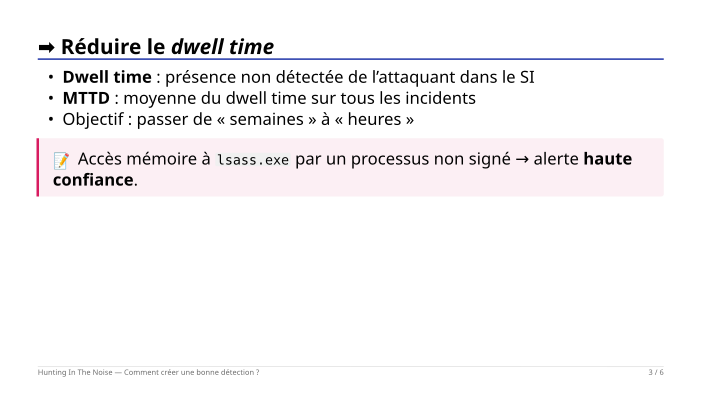 |
| `soc` | 🖥️ Night SOC: dark console, phosphor green, `>` prompt and cursor | 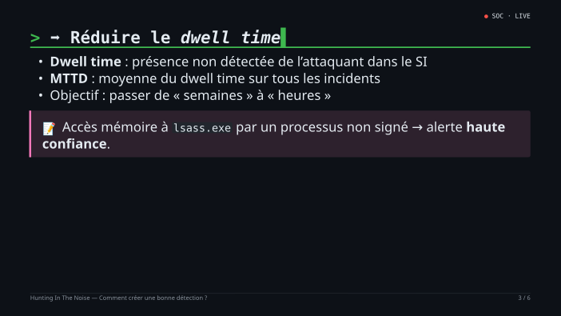 |
| `crise` | 🚨 Crisis cell: hazard tape, alert red, capitals | 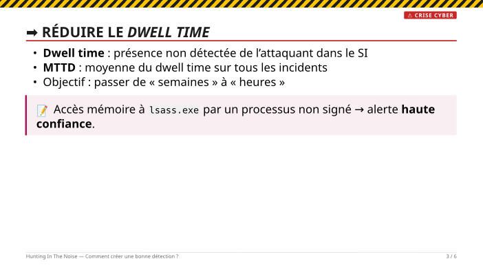 |
| `tlp` | 🗂️ Incident report: paper, typewriter, `TLP:CLEAR` marking | 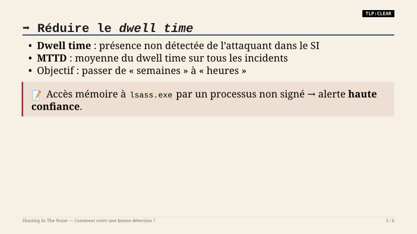 |
| `bouclier` | 🛡️ Blue Team: navy banner, electric blue | 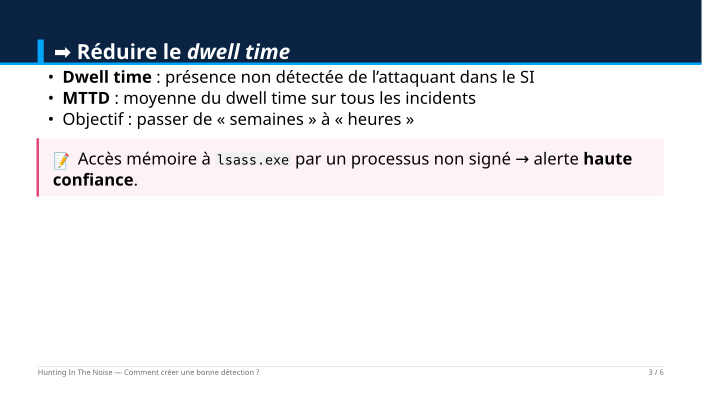 |
| `neon` | 😈 Neon Red Team: night purple, magenta and cyan, "glitch" headings | 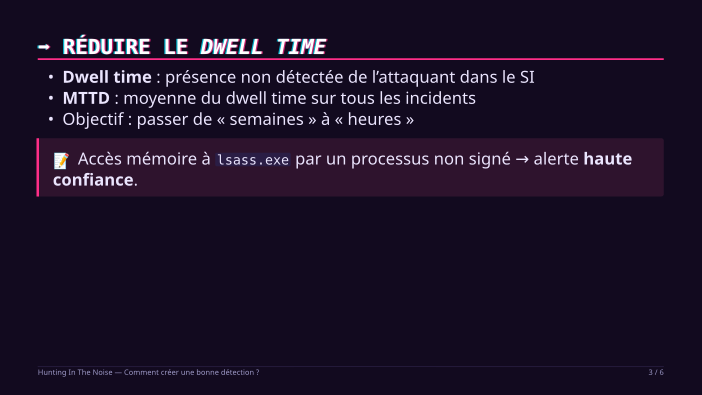 |

Good to know:

- With `soc` and `neon`, the slides and the site are **dark**, but the A4 stays
  light (it is meant to be printed).
- Monospaced fonts (`soc`, `tlp`, `neon`) are wider: a full slide
  may overflow onto a "(suite)" slide that does not exist with classique.
  Check with the theme you will actually project.
- Blocks keep their role from one theme to another: `#synthese`, `#question`,
  etc. change colors, never behavior.

**Going further**: [manuel/themes.md](manuel/themes.md) shows each
theme in full (cover, chapter, table, question, A4, site) and
explains how to create or tweak a theme in
[lib/theme.typ](lib/theme.typ) and [lib/site.css](lib/site.css).
